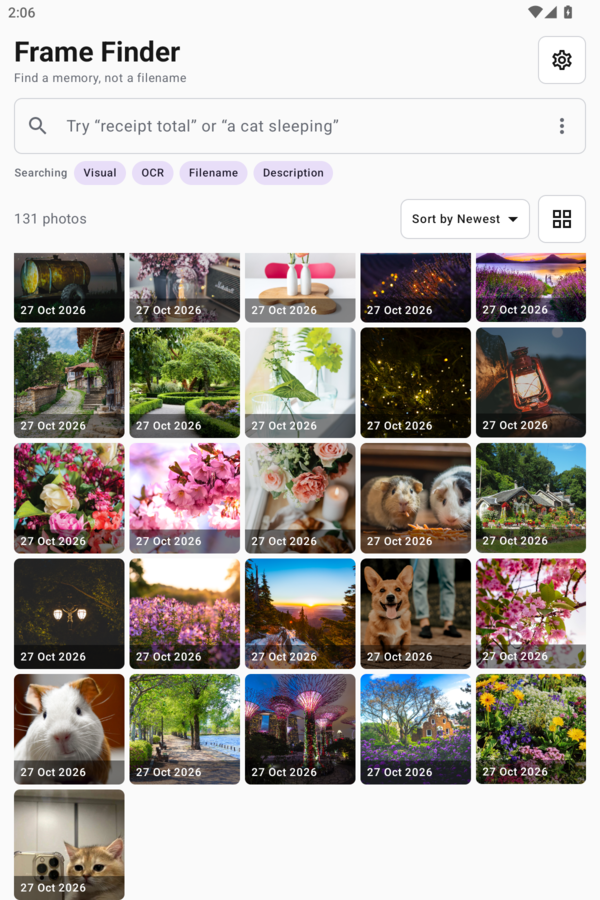
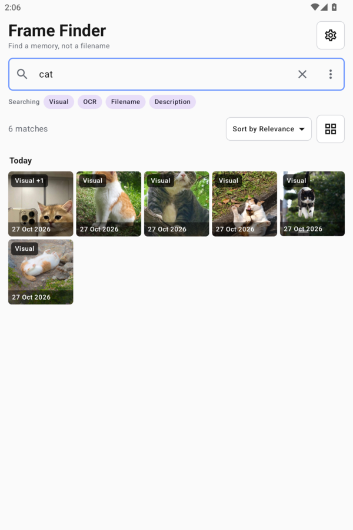
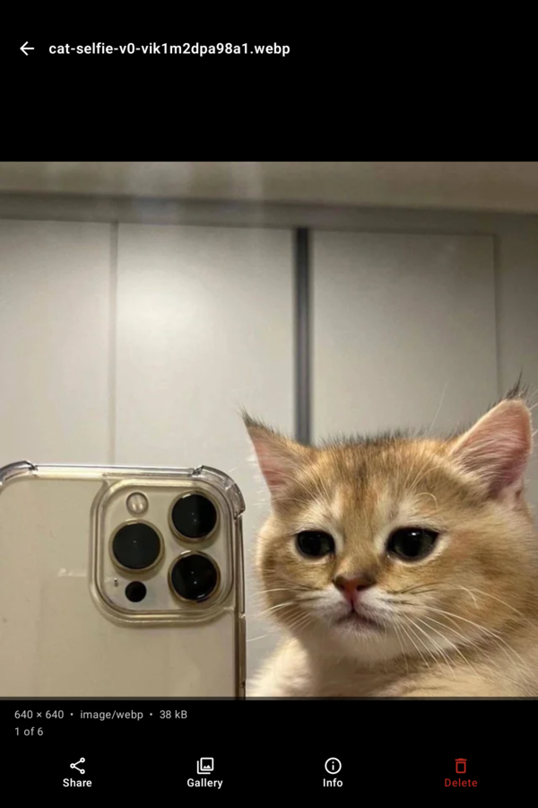
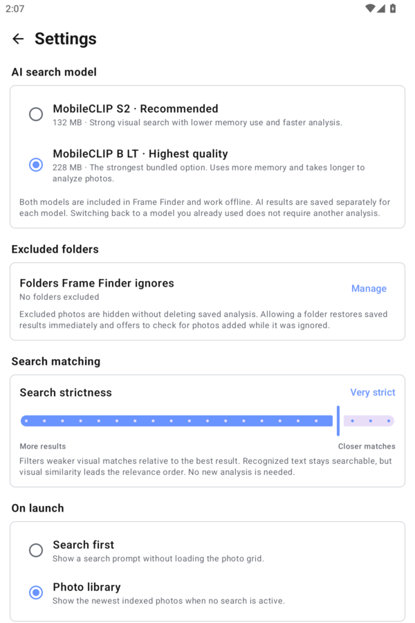

# Frame Finder

**Private, offline photo search for Android**

Frame Finder helps you find photos by what they contain, not just by their filenames. Search for things such as `a cat sleeping`, `watch`, or `receipt total`, and Frame Finder searches both the image itself and text visible inside it.

Everything happens on your device. Your photos, searches, recognized text, and analysis data are never uploaded.

<p align="center">
  
  
  
  
</p>

## Highlights

- Search photos using ordinary descriptions with on-device AI.
- Find screenshots, receipts, documents, and signs using built-in text recognition.
- Choose whether OCR, filenames, and media descriptions contribute to results.
- Adjust search strictness without analyzing the library again.
- Switch between grid and list views, group photos, and sort by relevance, date, name, or size.
- Swipe between photos, zoom and pan, share, inspect metadata, open in a gallery, move to trash, or permanently delete.
- Select multiple photos for batch deletion.
- Exclude folders without deleting their saved analysis.
- Pause a scan safely after the active photos finish, then resume from completed work.
- Export and import analysis data so reinstalling does not require starting from scratch.
- Optionally protect the app with the phone's existing screen lock.

Frame Finder is designed for large libraries. The gallery and thumbnails load as needed, and new photos are indexed only when you approve it. Opening the app never starts a full background scan by itself.

## Android compatibility

Frame Finder runs on **Android 8.0 Oreo and newer** (API 26 and above). It has been tested on recent Android devices running Android 12, 14 and 15. The app follows modern Android photo-access and background-processing requirements while retaining compatibility with older supported versions.

## Getting started

1. Grant access to all photos or an Android-selected set.
2. Choose an AI search model in Settings.
3. Tap **Index new photos** to begin the first analysis.
4. Search using a word, an object, visible text, or a short description.

The first analysis can take a while, especially with thousands of photos. Frame Finder shows progress and an estimated remaining time. Keeping the phone connected to a charger is recommended for large libraries.

When new photos are detected, Frame Finder asks whether you want to index them. It does not analyze them automatically.

## Search models

Both models are included in the app and work without a download.

| Model | Size | Best for |
|---|---:|---|
| MobileCLIP S2 | 132 MB | Recommended balance of speed, memory use, and search quality |
| MobileCLIP B LT | 228 MB | Better visual search quality with slower analysis and higher memory use |

Analysis is saved separately for each model. Returning to a model you already used does not require analyzing those photos again.

## Privacy

Frame Finder does not require an account or an internet connection. AI analysis and OCR run locally, and the index is stored in the app's private database.

Analysis backups contain metadata, recognized text, and AI search data, but not the original photos. Backup files are compressed but not encrypted, so keep them somewhere private. They are most reliable when restored to the same device and photo library.

## Build and install

Requirements:

- JDK 17
- Android SDK 35
- Git LFS
- A connected Android device or emulator

The bundled AI models are stored with Git LFS. After cloning, make sure the full model files are available before building:

```bash
git lfs install
git lfs pull
```

For the default x86_64 Genymotion build, install directly with:

```bash
./gradlew installDebug
```

For a typical ARM64 phone:

```bash
./gradlew assembleDebug -PframefinderAbis=arm64-v8a
adb install -r app/build/outputs/apk/debug/app-arm64-v8a-debug.apk
```

Run the unit tests with:

```bash
./gradlew testDebugUnitTest
```

The application ID is `com.souravgoswami.framefinder`. The current version is **1.0.0**.

For development builds, personal signing keys, release APKs, and Play Store bundles, see [DEVELOPMENT.md](DEVELOPMENT.md). The official release key and all developer keys remain outside Git.

## Notes

- OCR currently recognizes Latin-script text.
- Visual search quality varies by subject. Search strictness can be adjusted from the search menu or Settings.
- With Android's selected-photo permission, Frame Finder can search only the photos Android makes available to it.
- Moving a backup to another phone does not move the original images. Entries that do not resolve to an available photo are ignored and cleaned up safely.

## Credits and notices

Frame Finder uses [MobileCLIP](https://github.com/apple-aiml-research/ml-mobileclip), [ONNX Runtime](https://onnxruntime.ai/), and [Google ML Kit Text Recognition](https://developers.google.com/ml-kit/vision/text-recognition/v2/android).

See [THIRD_PARTY_NOTICES.md](THIRD_PARTY_NOTICES.md) for model and runtime licence information.

## Licence

Frame Finder source code is available under the [MIT Licence](LICENCE).

Bundled model files and third party components remain subject to their respective licences. See [THIRD_PARTY_NOTICES.md](THIRD_PARTY_NOTICES.md) before redistributing the application or its model files.
